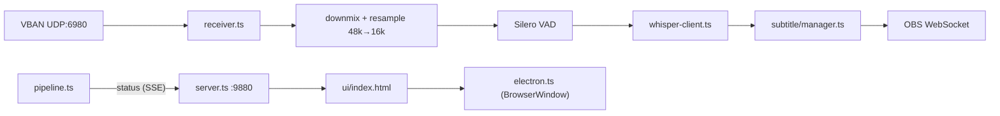

# AGENTS.md

## Project

jimaku-translator — a real-time subtitle system for OBS. An Electron application that receives OBS audio over VBAN (UDP), runs JA recognition + EN translation with Whisper, and updates subtitle text sources through OBS WebSocket v5. A GUI shows the status and lets you change the settings.

## Tech stack

See `package.json` for the version of each package.

- Node.js 22.12+, TypeScript, CJS (CommonJS output)
- Electron (GUI window + packaging)
- obs-websocket-js (OBS WebSocket v5 client)
- onnxruntime-node (Silero VAD)
- smol-toml (reading the settings file)
- vitest (unit tests)
- Playwright (E2E tests)
- electron-builder (Windows/macOS packaging)
- External process: whisper.cpp server (HTTP API)

## Commands

```bash
npm run dev           # CLI mode (tsx + GUI server)
npm run build         # tsc build → dist/ + copy the UI
npm run start         # run the built CLI mode
npm run electron      # launch the Electron GUI
npm run dist:win      # build the Windows installer (.exe)
npm run dist:mac      # build the macOS disk image (.dmg) + notarization
npm run dist:mac:app  # build only the macOS .app (--dir; signing and notarization run, dmg/zip skipped)
npm test              # vitest unit tests
npm run test:watch    # vitest watch mode
npm run test:e2e      # Playwright E2E tests
```

## Architecture



## Directory structure

```
src/
  index.ts              CLI entry point
  electron.ts           Electron main process
  app-quit.ts           stops the pipeline before the app quits
  pipeline.ts           pipeline logic (EventEmitter)
  server.ts             HTTP server (REST API + SSE)
  config.ts             TOML loading + validation
  updater.ts            electron-updater setup in the packaged app
  update-controller.ts  check / download / restart driven by the GUI server
  ui/
    index.html          Web UI (inline CSS/JS, dark theme)
  vban/
    protocol.ts         VBAN packet definitions and parser (28B header + PCM)
    receiver.ts         UDP socket + EventEmitter
  audio/
    resample.ts         stereo→mono + 48kHz→16kHz (7-tap FIR decimation)
    ring-buffer.ts      INT16 ring buffer
    vad.ts              Silero VAD v5 ONNX wrapper (512-sample chunks)
    level.ts            RMS / dBFS conversion, noise floor tracking, speech segment normalization
    wav.ts              INT16 mono PCM → WAV encoder
  recognition/
    whisper-client.ts   whisper.cpp server HTTP client (timeout + retry)
    whisper-process.ts  whisper-server child process management (spawn/kill/health poll)
    whisper-setup.ts    binary/model registry + download + GPU detection
  obs/
    client.ts           OBS WebSocket client (automatic reconnection, text source enumeration)
  subtitle/
    manager.ts          subtitle display, automatic clear, line wrapping
tests/                  vitest unit tests
e2e/                    Playwright E2E tests
docs/
  decisions/            closed decisions (English `<topic>.md` + Japanese `<topic>.ja.md`)
models/
  silero_vad.onnx       Silero VAD model
config.toml             default settings
```

## Conventions

- Add the `.js` extension to imports (required by CJS + Node16 moduleResolution)
- Unit tests go in `tests/` as `*.test.ts`; E2E tests go in `e2e/`
- Closed decisions (what was chosen, why, and what was turned down) go in `docs/decisions/`, English at `<topic>.md` with the Japanese version at `<topic>.ja.md` next to it
- Do not swallow errors; catch them at safe points in the pipeline and log them
- OBS WebSocket calls must be guarded by `isConnected()`
- **Override of the global CLAUDE.md's 「ドキュメント」 language rule**: this file is written entirely in English, and the documents for people are English at `<name>.md` with a Japanese translation at `<name>.ja.md` next to it (`README{,.ja}.md`).

## Key design decisions

- **The VBAN parser is implemented in-house**: the fixed 28B header is simple. No external library. Only `node:dgram`
- **Resampling is on the receiving side**: obs-vban can also output 16kHz, but sending 48kHz + converting in the app is more flexible
- **whisper.cpp is a separate process**: separated through the HTTP API. When `binary` is set, the app starts/stops it automatically as a child process. When it is empty, it is managed manually
- **Inference queue limit of 3**: when Whisper is slow, old segments are discarded
- **Automatic OBS reconnection**: at 5-second intervals. It also retries automatically when the first connection fails (supports starting OBS later). Subtitle updates while disconnected are skipped safely. A request still waiting for OBS's answer when the connection closes rejects (`ObsClient.call()` in [src/obs/client.ts](src/obs/client.ts)); obs-websocket-js on its own leaves it pending forever
- **The GUI is localhost HTTP + SSE**: a `node:http` server (port 9880) provides the REST API + SSE. Electron loads localhost in a `BrowserWindow`. The GUI is also reachable from a browser in CLI mode. [src/server.ts](src/server.ts) answers 403 to a request whose `Host` is not `127.0.0.1:<port>` / `localhost:<port>` and to a non-GET request whose `Origin` is present and not a loopback origin, and 415 to a request body not declared as `application/json` (a POST without a body, such as `/api/obs/reconnect`, needs no `Content-Type`)
- **E2E tests test the HTTP server directly**: Playwright's Electron integration has Chromium version constraints, so the HTTP server is started as `webServer` and tested with an ordinary browser
- **The macOS Whisper binary is managed by Homebrew**: whisper.cpp's GitHub Releases have no macOS build, so it is installed with `brew install whisper-cpp`. `getInstalledBinary('homebrew')` detects `/opt/homebrew/bin` or `/usr/local/bin`. The GUI's "Download" button runs `brew install`
- **Settings changes take effect immediately**: when settings are saved from the GUI, every section (OBS, VBAN, Subtitle, VAD, Audio) is updated in memory immediately. A VBAN port change rebinds the UDP socket automatically. Only changes to the Whisper binary/model need a restart
- **Whisper inference runs sequentially**: whisper.cpp server is single-threaded. Parallel requests corrupt the results, so transcribe → translate run in order
- **Keeping CPU usage down**: whisper-server gets `--threads` explicitly (`config.whisper.threads`; when unset, `resolveThreadsDefault()` in [src/recognition/whisper-process.ts](src/recognition/whisper-process.ts) decides from the platform/variant: macOS / Windows GPU variants (cublas/cuda/vulkan) use a few threads, CPU-only uses half the number of logical cores). Silero VAD's `ort.InferenceSession.create()` specifies `intraOpNumThreads=1` / `interOpNumThreads=1` / `executionMode: 'sequential'`, removing the idle spin of the onnxruntime thread pool
- **Whether each model can translate**: controlled by the `canTranslate` flag. The turbo family, the kotoba family and anime-whisper cannot translate (they are based on distil-whisper and do not keep the translation task). When translation is needed, use an original Whisper model (large-v3, medium, small, base)
- **Quality baseline**: pass/fail of JA recognition is judged by the e2e `Recognition E2E` (run with `JT_E2E_RECOGNITION=1`) using `tests/fixtures/jp-*.wav` (Kyoko TTS), and each fixture passes when Levenshtein distance / expected character count < 0.3. The model is chosen from the installed ones in the order `medium` → `large-v3` → `small` → `base`
- **Checking recognition by hand**: automatic — after `npm run build`, run `JT_E2E_RECOGNITION=1 npx playwright test -g "Recognition E2E"`; [playwright.config.ts](playwright.config.ts) looks for Homebrew's `whisper-server` and an installed model under the data root and writes them, with the E2E VBAN port, to the E2E server's `config.local.toml` before the server starts (a `POST /api/config` does not start the managed whisper-server). By hand — `npm run dev`, then call `sendVbanWavs()` in [tests/helpers/send-vban.ts](tests/helpers/send-vban.ts) from a `tsx` script to send 48 kHz stereo INT16 WAV files to `127.0.0.1:6980`, and read the `[Whisper] <ms>ms | JA: …` log lines from `curl -N http://127.0.0.1:9880/api/events`. A fixture can be made with `say -v Kyoko … -o out.aiff && afconvert -f WAVE -d LEI16@48000 -c 2 out.aiff out.wav`. When whisper-server does not come up, look at the model path in its `loading model from '…'` log line (its output is forwarded to the app log): when the path is empty, check that `model_name` is a registry ID and that `getInstalledModel()` accepts the file (at least 90% of the expected size, and the `.sha256` sidecar present)
- **E2E and the VBAN port**: the E2E server listens for VBAN on its own UDP port (`JT_E2E_VBAN_PORT`, 16980 when unset), not on the default 6980. [playwright.config.ts](playwright.config.ts) writes the port to the E2E server's `config.local.toml` before the server starts, and `Recognition E2E` sends its fixtures there, so the audio that OBS on the same machine sends to the default port does not mix into them. The two `POST /api/capture` tests in [e2e/app.test.ts](e2e/app.test.ts) skip themselves while VBAN packets are arriving
- **Silero VAD**: 512-sample chunks + 64-sample context (input [1, 576]). feedQueue is serialized with a Promise chain, dropped above a depth limit of 4, and `.catch(() => {})` prevents the chain from breaking. The LSTM hidden state is reset automatically after 3 seconds of continuous non-speech (shortened because with 30 seconds the hidden state became biased and prob did not rise even in segments with high RMS, which was confirmed). A 500ms pre-speech ring buffer fills in the onset of speech. The LSTM state is reset on every `emitSpeech()` run (carrying the state over makes prob collapse for the next speech). In case prob collapses from vowel saturation, the silence branch also force-splits at `speechSampleCount >= maxSpeechSamples` (so that Whisper Dispatch fires reliably even when continuationRmsFloor pins silenceSamples at 0)
- **Audio preprocessing to improve recognition accuracy**: (1) RMS gate: RMS is computed before VAD, and the VAD feed is skipped when it is below `audio.rms_gate_db` (default -60, upper limit -30) (not skipped while VAD is in a speech segment). When `audio.adaptive_gate_enabled` (default false) is true, the gate is raised to the noise floor + `audio.adaptive_gate_margin_db`, capped at `audio.adaptive_gate_max_db`. The VAD state and the pre-speech buffer are frozen, so no onsets are lost. (2) Speech segment normalization: at VAD emit time, `normalizeToTarget()` in [src/audio/level.ts](src/audio/level.ts) measures RMS and amplifies to `audio.normalize_target_dbfs` (default -6), with a maximum gain of +20 dB to avoid amplifying the noise floor, and no attenuation. The normalization target is hidden in the GUI and can only be changed from `config.local.toml`. (3) The level meter display was also changed from peak → RMS so that it can be compared directly with the gate threshold
- **Parallel downloads**: the server manages multiple downloads in a Map. The UI shows the progress of each download separately with dynamic progress bars. Duplicate downloads of the same resource are rejected with 409
- **Download integrity verification**: the SHA-256 hash is saved in a sidecar file (`.sha256`). Missing sidecar = incomplete, and the installed state is refused
- **Data root and the legacy migration**: `getJimakuDataRoot()` in [src/recognition/whisper-setup.ts](src/recognition/whisper-setup.ts) returns `JIMAKU_DATA_DIR` when it is set, and a per-platform default otherwise (macOS: `~/Library/Application Support/Jimaku Translator`). Electron sets `JIMAKU_DATA_DIR` to `app.getPath('userData')` at startup. `migrateLegacyDataIfNeeded()` runs once at startup in both modes: when `<data root>/whisper` does not exist and a legacy directory does (`~/.jimaku-translator/whisper`, or `jimaku-translator/whisper` under the platform's application-data folder), it symlinks the legacy directory there, and copies it when the symlink cannot be made. So a test that points `JIMAKU_DATA_DIR` at an empty directory still sees the models installed on the machine when a legacy directory exists (the candidates are looked up from `os.homedir()` and, on Windows, `APPDATA`). `VBAN_WHISPER_DIR` overrides the Whisper directory and turns the migration off
- **Automatic Whisper server port assignment**: when the managed process is used, a free port is obtained automatically by binding port 0 with `net.createServer`. The server field was removed from the GUI
- **Window position restore**: on Electron exit, the bounds are saved to `window-state.json` and restored on the next launch. If it is off-display, the default position is used
- **CJS output**: Electron's `require('electron')` and `onnxruntime-node` do not work correctly through ESM interop, so CommonJS is output with `module: Node16` in `tsconfig.json` and no `"type": "module"` in `package.json`
- **onnxruntime-node is unpacked from the asar**: native `.node` binaries cannot be read from inside an asar, so they are extracted with `build.asar.unpack`
- **Quitting stops the pipeline**: a quit through `app.quit()` (the Quit menu item, `BaseUpdater.quitAndInstall`) does not emit `window-all-closed`, so `stopPipelineOnQuit()` ([src/app-quit.ts](src/app-quit.ts)) also holds `before-quit` with `preventDefault()` until `pipeline.stop()` has finished (subtitles cleared, OBS disconnected, whisper-server ended) and then quits again. The stop runs once whichever path asks first. The quit waits for it for at most `QUIT_STOP_TIMEOUT_MS` (5 s); a failed stop, or one still running at that point, is logged and the quit goes on. `pipeline.stop()` stops OBS (subtitle clear, disconnect) and whisper-server side by side, so an OBS that does not answer does not keep whisper-server running past the quit. A `pipeline.stop()` called while one is running waits for that stop (the CLI's second SIGINT/SIGTERM included). A quit after `before-quit-for-update` is not held
- **Preventing multiple instances**: `app.requestSingleInstanceLock()` guarantees a single instance. A second launch focuses the existing window
- **OBS subtitle errors are non-fatal**: failures of `subtitle.show()` are logged separately from OBS connection failures and inference failures. The inference result is kept and shown in the GUI
- **The subtitle send queue keeps everything FIFO**: `pendingQueue` in [src/subtitle/manager.ts](src/subtitle/manager.ts) does not discard recognition results that arrive during `clearDelay`; it queues them in FIFO order, and `drainPending()` sends them to OBS one at a time every `clearDelay` interval. To avoid losing continuous speech, it keeps everything rather than latest-wins. The queue has no limit; in practice it is bounded by the upstream `MAX_QUEUE = 3` (inference queue). `getPendingCount()` and the `'pendingChanged'` event expose the number of queued items, which the GUI's OBS card shows as "Send pending: N". The queue keeps filling as usual while OBS is disconnected, and `showNow()` consumes `clearDelay` while skipping OBS communication in the branch where `obs.isConnected()` is false (it spins idle, so there are no side effects) — clearing the queue or a no-op on disconnect is deliberately not adopted (to keep "send reliably without thinning out" literally)
- **Last Recognition is updated at Whisper response time**: the GUI's `lastResult` is set directly in `processQueue()` in [src/pipeline.ts](src/pipeline.ts) right after the whisper response is obtained, not on the `subtitle.displayed/cleared` events. Recognition results show up in the GUI immediately even while OBS is disconnected or the subtitle send queue is backed up. The `subtitle` `clearDelay` only controls how long OBS subtitles are shown and is independent of the GUI. `lastResult` is cleared only by `pipeline.stop()` (not by subtitle 'cleared')
- **Last Recognition's left sidebar = marker of the most recent completed send processing**: the pipeline issues a sequential `resultSeq` for each recognition result and passes it to both `lastResult.seq` and `subtitle.show(ja, en, seq)`. The `'displayed'` event always fires once through `try/finally` when the subtitle's dispatch handler completes (including all of: OBS connected and `updateSubtitle()` succeeded / skipped because OBS is disconnected / `updateSubtitle()` threw). A failure of `updateSubtitle()` (e.g. a wrong text source name) reaches the caller as a reject for an immediate send, and is discarded by `drainPending()` when it goes through `pendingQueue`. Either way, `'displayed'` is guaranteed to fire. The pipeline looks at the seq and advances `lastDispatchedSeq`, and the UI compares `status.obs.lastDispatchedSeq` with the `seq` of each history entry by **exact match**, adding the `.dispatched` class to **only the one entry** with `seq === lastDispatchedSeq` to show a green bar (`#22c55e`). Green = "the message whose dispatch processing ran most recently"; gray = "still waiting in the queue and not yet tried, or already old". The bar is always on only one entry and moves each time the queue advances. `pipeline.stop()` resets the seq counter and lastDispatchedSeq to 0
- **GUI collapsing + window height following**: the whole Configuration, each section and the Log panel can be collapsed. The state is persisted in `localStorage`. When collapsing, the Electron window height follows the content, and when expanding, it grows up to the saved maximum height
- **UI localization (EN/JA)**: the `data-i18n` attribute specifies the translation key. The language is detected from `navigator.language` and can be overridden with `[ui] language` in `config.local.toml`. "Status" and "Last Recognition" are deliberately kept in English
- **Bringing the macOS window to the front**: created with `show: false`, and `show()` + `focus()` on the `ready-to-show` event. It comes to the front reliably even if focus is lost while awaiting `pipeline.start()`
- **Third-party licenses**: the licenses of Silero VAD + the npm dependency packages are collected in `THIRD_PARTY_LICENSES.txt`, which is included in the NSIS installer's license screen and in `fileOptions.extraResources`
- **Windows exe icon and version info**: electron-builder 27 rewrites the exe's version resources after `afterPack` (`OriginalFilename` empty, a 4-part `ProductVersion`, `Copyright ©`), so [build/win-version-info.cjs](build/win-version-info.cjs) runs as the `artifactBuildStarted` hook when the NSIS target starts — after that rewrite and before NSIS packs the app directory — and writes the icon and version info with rcedit (`Copyright (C) <year> semnil`, `OriginalFilename` = `Jimaku Translator.exe`, `FileVersion` / `ProductVersion` = the `package.json` version). `afterPack.cjs` records each Windows app for it, and the hook fails the build when the NSIS target starts with nothing recorded ([tests/win-version-info.test.ts](tests/win-version-info.test.ts))
- **macOS signing and notarization**: the `.app` is signed with a Developer ID Application certificate. Hardened runtime + entitlements (`build/entitlements.mac.plist`). electron-builder's `notarize: true` notarizes and staples the `.app` automatically. electron-builder does not sign or notarize the DMG, so `build/notarize-dmg.cjs` runs after `dist:mac` to sign → notarytool submit --wait → stapler → spctl verification. It signs with the Developer ID Application identity of `APPLE_TEAM_ID`, which [build/signing-identity.cjs](build/signing-identity.cjs) finds in the keychain search list with `security find-identity` ([tests/signing-identity.test.ts](tests/signing-identity.test.ts)). Signing and stapling change the DMG after electron-builder wrote `latest-mac.yml`, so [build/refresh-dmg-update-info.cjs](build/refresh-dmg-update-info.cjs) runs last in `dist:mac` and rewrites the sha512 and size of the DMG entry from the final DMG ([tests/refresh-dmg-update-info.test.ts](tests/refresh-dmg-update-info.test.ts)). Credentials are injected as `APPLE_ID` / `APPLE_APP_SPECIFIC_PASSWORD` / `APPLE_TEAM_ID` through `node --env-file-if-exists=.env`. Keep `.env` with LF line endings (with CRLF, `\r` gets appended to the end of `APPLE_APP_SPECIFIC_PASSWORD` when it is `source`d and notarytool returns 401)
- **macOS Local Network permission**: on macOS, unicast TCP to a LAN address (OBS WebSocket on another PC) is refused until the user allows the app under Local Network, and the system looks that permission up by the main executable's `LC_UUID`. Electron's prebuilt binary has the same `LC_UUID` in every app built with the same Electron version, so [build/afterPack.cjs](build/afterPack.cjs) writes a random `LC_UUID` into the main executable before electron-builder signs it. The permission prompt appears only for mDNS / multicast / broadcast traffic, so `primeLocalNetworkPermission()` in [src/electron.ts](src/electron.ts) sends one DNS-SD query to the mDNS multicast group (UDP 5353) and starts `/usr/bin/dns-sd -B` for a moment once the app is ready. Both are needed: with the shared `LC_UUID` the request is attributed to `com.github.Electron` and no prompt appears for this app. `mac.extendInfo.NSLocalNetworkUsageDescription` in `package.json` is the text of the prompt
- **macOS Tahoe Liquid Glass icon**: for an Electron 40+ app linked with the macOS 26 SDK, with only `.icns` the Liquid Glass UI judges it a "legacy icon" and shows it surrounded by a white squircle plate. To be recognized as Tahoe-native, the Asset Catalog (`Assets.car`) needs `IconGroup` / `IconImageStack` / `PackedImage` entries, which are produced only when an `.icon` bundle (`AppIcon.icon/icon.json` + `Assets/*.png`) is compiled with `xcrun actool --include-all-app-icons --target-device mac` (`.xcassets/AppIcon.appiconset/` only produces an `Icon Image` entry and is treated as legacy). `mac.fileOptions.extraResources` places `Assets.car` in `Resources/`, and `mac.extendInfo.CFBundleIconName=AppIcon` refers to it. [build/generate-icon.py](build/generate-icon.py) generates the icon assets `build/icon.{png,ico,icns}` + `build/Assets.car` in one go (the PNG/ICNS/Assets.car body is the Liquid Glass squircle with radius 22.5%; only the ICO uses the legacy radius of 18.75%). The `.icns` is kept alongside for pre-Tahoe compatibility. Verify with `xcrun assetutil --info Assets.car` that `IconGroup` etc. appear
- **auto-update**: `electron-updater` refers to GitHub Releases as the `publish` provider. `initAutoUpdater()` ([src/updater.ts](src/updater.ts)) sets `autoDownload: false` + `autoInstallOnAppQuit: true` and returns the `UpdateController` ([src/update-controller.ts](src/update-controller.ts)) that `createServer()` drives through `/api/update/*`. It returns null when `app.isPackaged` is false, and CLI mode passes none, so `GET /api/update/status` answers `supported: false` there. The GUI page runs the launch check after `/api/config` has loaded (so the confirm uses the configured language): when `launch_pending` is true (an updater, `[update] check_at_launch` on, and no launch check yet in this process) it posts `/api/update/check` with `launch: true`; the server runs the launch check once per process, so a window reload does not repeat it. When a newer version is offered, `window.confirm` asks to update now. Declining downloads nothing; the next launch check or "Check now" asks again. Accepting posts `/api/update/install`, which downloads the offered version (again on a retry; electron-updater reuses a valid cached file), answers, awaits the stop that `stopPipelineOnQuit()` returns (at most 5 s, shared with the quit handler), then calls `quitAndInstall(true, true)` (`isSilent`, `isForceRunAfter`; on macOS Squirrel.Mac installs it). The install stops the pipeline itself, so the quit handler in [src/app-quit.ts](src/app-quit.ts) leaves that quit alone (it is marked by `before-quit-for-update`). An updater error raised after that reaches the page as the SSE event `update-error`. `[update] check_at_launch` is written only by `POST /api/update/settings`; `POST /api/config` keeps the in-memory value whatever the body says. electron-builder does not detect draft releases, so the draft that `release.yaml` creates has to be **published manually** on GitHub. Signing is required on macOS (Gatekeeper rejects applying an unsigned difference). Including `latest.yml` / `latest-mac.yml` / `*.blockmap` in the release artifacts enables differential updates. The macOS targets keep `zip` beside `dmg`: electron-updater's macOS updater installs from the zip and does not use the DMG. To prevent double uploads by electron-builder and softprops, `dist:win` / `dist:mac` specify `--publish=never`
- **macOS auto-update minimum-OS guard**: [build/set-min-system-version.cjs](build/set-min-system-version.cjs) injects `minimumSystemVersion` into the generated `dist/latest-mac.yml` after `dist:mac` / `dist:mac:unsigned`. electron-builder does not write this field itself (`mac.minimumSystemVersion` only sets the app's `LSMinimumSystemVersion`, and the `releaseInfo` schema is `additionalProperties: false`, so the field cannot go through config). electron-updater's `checkIfUpdateSupported()` compares the field against `os.release()` — the Darwin kernel version, not the macOS product version — so the injected value is the Darwin version of the bundled Electron's minimum macOS (`MIN_DARWIN_VERSION` in the script). Hosts below it are refused the update instead of downloading a build that cannot launch. The script is idempotent (it leaves an existing `minimumSystemVersion` untouched) and fails with a non-zero exit if `latest-mac.yml` is missing. [tests/set-min-system-version.test.ts](tests/set-min-system-version.test.ts) locks the value and the boundary just below it
- **`build.fileOptions.files` is a whitelist**: wrapping all of `dist/**/*` makes electron-builder recursively pull past releases' `*.zip` / `*.dmg` / `latest-mac.yml` etc. that it outputs to `dist/` into the next build's app.asar, doubling the size every generation (in jimaku-translator, 1.0.6: 139MB → 1.0.7: 542MB → 1.0.10: 810MB happened). Only `dist/*.js` + `**/*.js` of each subdirectory are listed explicitly, and before building, [build/clean-dist.cjs](build/clean-dist.cjs) (`npm run clean:dist`) cleans past artifacts (`*.dmg` / `*.exe` / `*.zip` / `*.blockmap` / `*.yml` / `*.yaml` / `builder-*` / `mac-arm64` / `win-unpacked` / `.icon-*`). It runs automatically at the start of `dist:win` / `dist:mac` / `dist:mac:app` / `dist:mac:unsigned`. A healthy `app.asar` is a few MB; `node_modules/.bin/asar extract` + `du -sh` shows what was packed when it is larger
- **`mac.electronLanguages` limited to en/ja**: the 50+ language lproj bundled with Electron are empty placeholders, and there is no point distributing languages other than English and Japanese. Reduced with `mac.electronLanguages: ["en", "ja"]` (about -40MB of Frameworks size)
- **GitHub Actions release**: merging a version-bump PR (a PR that changes only the version in `package.json` and `package-lock.json`) is the starting point of a release. When CI (`ci.yaml`) succeeds on a push to main, [.github/workflows/tag-release.yaml](.github/workflows/tag-release.yaml) compares that commit's `version` with its first parent, and if it changed, tags the commit CI checked with `vX.Y.Z` and starts [.github/workflows/release.yaml](.github/workflows/release.yaml) on the tag with `workflow_dispatch` (a tag pushed with `GITHUB_TOKEN` does not start workflows). A push that does not change `version` does nothing. So that the first parent is the tip of main before the merge, main's ruleset limits the merge methods to merge and squash (with a rebase merge, a version-bump PR with 2 or more commits is missed when the bump is not the last commit). If a tag with the same name already exists on the remote, it is not moved, and if it points to a different commit, the job fails. The version comparison and the tag-shape check live in [build/release-tag.cjs](build/release-tag.cjs), and `check-event` in `release.yaml` also checks the tag with the same script. `release.yaml` also starts on a manual push of a `v*.*.*` tag, and `workflow_dispatch` on a branch only builds (the macOS job still signs and notarizes when the signing secrets are set, and the builds stay as the jobs' artifacts). It builds + runs tests on Windows (windows-2022) + macOS (macos-15) and creates a draft release. Release notes are generated automatically by GitHub with `generate_release_notes: true`. The macOS secrets are `MACOS_SIGNING_CERT` / `MACOS_SIGNING_CERT_PASSWORD` / `MACOS_NOTARIZATION_USERNAME` / `MACOS_NOTARIZATION_PASSWORD` / `MACOS_NOTARIZATION_TEAM_ID` (the `MACOS_` prefix naming convention shared with MixTrack2Source). When `MACOS_SIGNING_CERT` is not set, it falls back automatically to `npm run dist:mac:unsigned`, producing a DMG without signing or notarization and continuing the build. When it is set, the certificate is imported into a persistent keychain under `$RUNNER_TEMP` before `dist:mac` runs (to avoid the problem where electron-builder's `CSC_LINK` path discards the temporary keychain after signing and the later `notarize-dmg.cjs` loses the identity)

## GUI

The HTTP server (`127.0.0.1:9880`) provides the following:

- `GET /` — Web UI (status panel + settings form + log)
- `GET /api/status` — pipeline status JSON
- `GET /api/config` — current settings JSON
- `POST /api/config` — save settings to `config.local.toml` (input validation + TOML escaping)
- `POST /api/obs/reconnect` — reconnect OBS WebSocket immediately
- `GET /api/obs/sources` — list of OBS text sources (GDI+ / FreeType2)
- `GET /api/whisper/variants` — list of binary variants + GPU recommendation + installation status
- `GET /api/whisper/models` — list of models + installation status
- `POST /api/whisper/download-binary` — download a binary (progress notified over SSE)
- `POST /api/whisper/download-model` — download a model (progress notified over SSE)
- `POST /api/whisper/download-cancel` — cancel a download (by ID)
- `POST /api/capture` — 16kHz mono WAV capture (up to 30 seconds)
- `GET /api/update/status` — running version, whether updates are supported, the "Check at launch" setting, and whether the launch check is pending
- `POST /api/update/settings` — save "Check at launch" (`launch_check`) to `config.local.toml`
- `POST /api/update/check` — check GitHub Releases for a newer version (`launch: true` for the once-per-process launch check)
- `POST /api/update/install` — download the version the last check offered, then quit and install it
- `GET /api/events` — SSE stream (status + log + download-progress + update-error events)

## Settings

`config.toml` (default values are defined in `DEFAULTS` in `src/config.ts`). Validation is done by `validateConfig()` (exported). See README.md for details on where data is stored.

## External dependencies

- **obs-vban** (on the OBS PC): https://github.com/norihiro/obs-vban
- **whisper.cpp** (on the subtitle PC): `whisper-server -m ggml-large-v3.bin --host 127.0.0.1 --port 8080`
- **Silero VAD**: the model file is bundled at `models/silero_vad.onnx`
