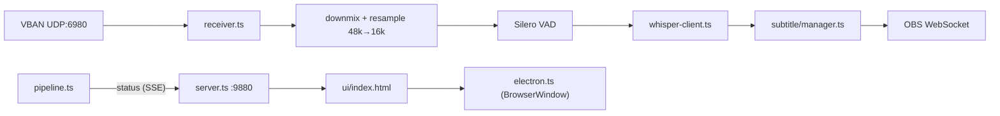

# CLAUDE.md

## Project

jimaku-translator — a real-time subtitle system for OBS. An Electron application that receives OBS audio over VBAN (UDP), runs JA recognition + EN translation with Whisper, and updates subtitle text sources through OBS WebSocket v5. A GUI shows the status and lets you change the settings.

## Tech stack

See `package.json` for the version of each package.

- Node.js 20+, TypeScript, CJS (CommonJS output)
- Electron (GUI window + packaging)
- obs-websocket-js (OBS WebSocket v5 client)
- onnxruntime-node (Silero VAD)
- smol-toml (reading the settings file)
- vitest (unit tests)
- Playwright (E2E tests)
- electron-builder (Windows/macOS packaging)
- External process: whisper.cpp server (HTTP API)

## Commands

```bash
npm run dev           # CLI mode (tsx + GUI server)
npm run build         # tsc build → dist/ + copy the UI
npm run start         # run the built CLI mode
npm run electron      # launch the Electron GUI
npm run dist:win      # build the Windows installer (.exe)
npm run dist:mac      # build the macOS disk image (.dmg) + notarization
npm run dist:mac:app  # build only the macOS .app (--dir; signing and notarization run, dmg/zip skipped)
npm test              # vitest unit tests
npm run test:watch    # vitest watch mode
npm run test:e2e      # Playwright E2E tests
```

## Architecture



## Directory structure

```
src/
  index.ts              CLI entry point
  electron.ts           Electron main process
  pipeline.ts           pipeline logic (EventEmitter)
  server.ts             HTTP server (REST API + SSE)
  config.ts             TOML loading + validation
  updater.ts            auto-update with electron-updater
  ui/
    index.html          Web UI (inline CSS/JS, dark theme)
  vban/
    protocol.ts         VBAN packet definitions and parser (28B header + PCM)
    receiver.ts         UDP socket + EventEmitter
  audio/
    resample.ts         stereo→mono + 48kHz→16kHz (7-tap FIR decimation)
    ring-buffer.ts      INT16 ring buffer
    vad.ts              Silero VAD v5 ONNX wrapper (512-sample chunks)
    level.ts            RMS / dBFS conversion, noise floor tracking, speech segment normalization
    wav.ts              INT16 mono PCM → WAV encoder
  recognition/
    whisper-client.ts   whisper.cpp server HTTP client (timeout + retry)
    whisper-process.ts  whisper-server child process management (spawn/kill/health poll)
    whisper-setup.ts    binary/model registry + download + GPU detection
  obs/
    client.ts           OBS WebSocket client (automatic reconnection, text source enumeration)
  subtitle/
    manager.ts          subtitle display, automatic clear, line wrapping
tests/                  vitest unit tests
e2e/                    Playwright E2E tests
models/
  silero_vad.onnx       Silero VAD model
docs/
  security-audit.md     security audit report
config.toml             default settings
```

## Conventions

- Add the `.js` extension to imports (required by CJS + Node16 moduleResolution)
- Unit tests go in `tests/` as `*.test.ts`; E2E tests go in `e2e/`
- Do not swallow errors; catch them at safe points in the pipeline and log them
- OBS WebSocket calls must be guarded by `isConnected()`
- **Override of the global CLAUDE.md's 「ドキュメント」 language rule**: this file is written entirely in English, and the documents for people are English at `<name>.md` with a Japanese translation at `<name>.ja.md` next to it (`README{,.ja}.md`). `docs/security-audit.md` is English only and has no Japanese translation

## Key design decisions

- **The VBAN parser is implemented in-house**: the fixed 28B header is simple. No external library. Only `node:dgram`
- **Resampling is on the receiving side**: obs-vban can also output 16kHz, but sending 48kHz + converting in the app is more flexible
- **whisper.cpp is a separate process**: separated through the HTTP API. When `binary` is set, the app starts/stops it automatically as a child process. When it is empty, it is managed manually
- **Inference queue limit of 3**: when Whisper is slow, old segments are discarded
- **Automatic OBS reconnection**: at 5-second intervals. It also retries automatically when the first connection fails (supports starting OBS later). Subtitle updates while disconnected are skipped safely
- **The GUI is localhost HTTP + SSE**: a `node:http` server (port 9880) provides the REST API + SSE. Electron loads localhost in a `BrowserWindow`. The GUI is also reachable from a browser in CLI mode
- **E2E tests test the HTTP server directly**: Playwright's Electron integration has Chromium version constraints, so the HTTP server is started as `webServer` and tested with an ordinary browser
- **The macOS Whisper binary is managed by Homebrew**: whisper.cpp's GitHub Releases have no macOS build, so it is installed with `brew install whisper-cpp`. `getInstalledBinary('homebrew')` detects `/opt/homebrew/bin` or `/usr/local/bin`. The GUI's "Download" button runs `brew install`
- **Settings changes take effect immediately**: when settings are saved from the GUI, every section (OBS, VBAN, Subtitle, VAD, Audio) is updated in memory immediately. A VBAN port change rebinds the UDP socket automatically. Only changes to the Whisper binary/model need a restart
- **Whisper inference runs sequentially**: whisper.cpp server is single-threaded. Parallel requests corrupt the results, so transcribe → translate run in order
- **Keeping CPU usage down**: whisper-server gets `--threads` explicitly (`config.whisper.threads`; when unset, `resolveThreadsDefault()` in [src/recognition/whisper-process.ts](src/recognition/whisper-process.ts) decides from the platform/variant: macOS / Windows GPU variants (cublas/cuda/vulkan) use a few threads, CPU-only uses half the number of logical cores). Silero VAD's `ort.InferenceSession.create()` specifies `intraOpNumThreads=1` / `interOpNumThreads=1` / `executionMode: 'sequential'`, removing the idle spin of the onnxruntime thread pool
- **Whether each model can translate**: controlled by the `canTranslate` flag. The turbo family, the kotoba family and anime-whisper cannot translate (they are based on distil-whisper and do not keep the translation task). When translation is needed, use an original Whisper model (large-v3, medium, small, base)
- **Quality baseline**: pass/fail of JA recognition is judged by the e2e `Recognition E2E` (run with `JT_E2E_RECOGNITION=1`) using `tests/fixtures/jp-*.wav` (Kyoko TTS), and each fixture passes when Levenshtein distance / expected character count < 0.3. The model is chosen from the installed ones in the order `medium` → `large-v3` → `small` → `base`
- **Silero VAD**: 512-sample chunks + 64-sample context (input [1, 576]). feedQueue is serialized with a Promise chain, dropped above a depth limit of 4, and `.catch(() => {})` prevents the chain from breaking. The LSTM hidden state is reset automatically after 3 seconds of continuous non-speech (shortened because with 30 seconds the hidden state became biased and prob did not rise even in segments with high RMS, which was confirmed). A 500ms pre-speech ring buffer fills in the onset of speech. The LSTM state is reset on every `emitSpeech()` run (carrying the state over makes prob collapse for the next speech). In case prob collapses from vowel saturation, the silence branch also force-splits at `speechSampleCount >= maxSpeechSamples` (so that Whisper Dispatch fires reliably even when continuationRmsFloor pins silenceSamples at 0)
- **Audio preprocessing to improve recognition accuracy**: (1) RMS gate: RMS is computed before VAD, and the VAD feed is skipped when it is below `audio.rms_gate_db` (default -60, upper limit -30) (not skipped while VAD is in a speech segment). When `audio.adaptive_gate_enabled` (default false) is true, the gate is raised to the noise floor + `audio.adaptive_gate_margin_db`, capped at `audio.adaptive_gate_max_db`. The VAD state and the pre-speech buffer are frozen, so no onsets are lost. (2) Speech segment normalization: at VAD emit time, `normalizeToTarget()` in [src/audio/level.ts](src/audio/level.ts) measures RMS and amplifies to `audio.normalize_target_dbfs` (default -6), with a maximum gain of +20 dB to avoid amplifying the noise floor, and no attenuation. The normalization target is hidden in the GUI and can only be changed from `config.local.toml`. (3) The level meter display was also changed from peak → RMS so that it can be compared directly with the gate threshold
- **Parallel downloads**: the server manages multiple downloads in a Map. The UI shows the progress of each download separately with dynamic progress bars. Duplicate downloads of the same resource are rejected with 409
- **Download integrity verification**: the SHA-256 hash is saved in a sidecar file (`.sha256`). Missing sidecar = incomplete, and the installed state is refused
- **Automatic Whisper server port assignment**: when the managed process is used, a free port is obtained automatically by binding port 0 with `net.createServer`. The server field was removed from the GUI
- **Window position restore**: on Electron exit, the bounds are saved to `window-state.json` and restored on the next launch. If it is off-display, the default position is used
- **CJS output**: Electron's `require('electron')` and `onnxruntime-node` do not work correctly through ESM interop, so CommonJS is output with `module: Node16` in `tsconfig.json` and no `"type": "module"` in `package.json`
- **asar integrity afterPack fix**: electron-builder has a bug where it computes the hash before the asar is finalized, so `afterPack.cjs` recomputes the SHA-256 + 4MB block array and overwrites Info.plist. It uses `execFileSync` (argument array) to prevent command injection
- **onnxruntime-node is asarUnpack**: native `.node` binaries cannot be read from inside an asar, so they are extracted with `asarUnpack`
- **Preventing multiple instances**: `app.requestSingleInstanceLock()` guarantees a single instance. A second launch focuses the existing window
- **OBS subtitle errors are non-fatal**: failures of `subtitle.show()` are logged separately from OBS connection failures and inference failures. The inference result is kept and shown in the GUI
- **The subtitle send queue keeps everything FIFO**: `pendingQueue` in [src/subtitle/manager.ts](src/subtitle/manager.ts) does not discard recognition results that arrive during `clearDelay`; it queues them in FIFO order, and `drainPending()` sends them to OBS one at a time every `clearDelay` interval. To avoid losing continuous speech, it keeps everything rather than latest-wins. The queue has no limit; in practice it is bounded by the upstream `MAX_QUEUE = 3` (inference queue). `getPendingCount()` and the `'pendingChanged'` event expose the number of queued items, which the GUI's OBS card shows as "Send pending: N". The queue keeps filling as usual while OBS is disconnected, and `showNow()` consumes `clearDelay` while skipping OBS communication in the branch where `obs.isConnected()` is false (it spins idle, so there are no side effects) — clearing the queue or a no-op on disconnect is deliberately not adopted (to keep "send reliably without thinning out" literally)
- **Last Recognition is updated at Whisper response time**: the GUI's `lastResult` is set directly in `processQueue()` in [src/pipeline.ts](src/pipeline.ts) right after the whisper response is obtained, not on the `subtitle.displayed/cleared` events. Recognition results show up in the GUI immediately even while OBS is disconnected or the subtitle send queue is backed up. The `subtitle` `clearDelay` only controls how long OBS subtitles are shown and is independent of the GUI. `lastResult` is cleared only by `pipeline.stop()` (not by subtitle 'cleared')
- **Last Recognition's left sidebar = marker of the most recent completed send processing**: the pipeline issues a sequential `resultSeq` for each recognition result and passes it to both `lastResult.seq` and `subtitle.show(ja, en, seq)`. The `'displayed'` event always fires once through `try/finally` when the subtitle's dispatch handler completes (including all of: OBS connected and `updateSubtitle()` succeeded / skipped because OBS is disconnected / `updateSubtitle()` threw). A failure of `updateSubtitle()` (e.g. a wrong text source name) reaches the caller as a reject for an immediate send, and is discarded by `drainPending()` when it goes through `pendingQueue`. Either way, `'displayed'` is guaranteed to fire. The pipeline looks at the seq and advances `lastDispatchedSeq`, and the UI compares `status.obs.lastDispatchedSeq` with the `seq` of each history entry by **exact match**, adding the `.dispatched` class to **only the one entry** with `seq === lastDispatchedSeq` to show a green bar (`#22c55e`). Green = "the message whose dispatch processing ran most recently"; gray = "still waiting in the queue and not yet tried, or already old". The bar is always on only one entry and moves each time the queue advances. `pipeline.stop()` resets the seq counter and lastDispatchedSeq to 0
- **GUI collapsing + window height following**: the whole Configuration, each section and the Log panel can be collapsed. The state is persisted in `localStorage`. When collapsing, the Electron window height follows the content, and when expanding, it grows up to the saved maximum height
- **UI localization (EN/JA)**: the `data-i18n` attribute specifies the translation key. The language is detected from `navigator.language` and can be overridden with `[ui] language` in `config.local.toml`. "Status" and "Last Recognition" are deliberately kept in English
- **Bringing the macOS window to the front**: created with `show: false`, and `show()` + `focus()` on the `ready-to-show` event. It comes to the front reliably even if focus is lost while awaiting `pipeline.start()`
- **Third-party licenses**: the licenses of Silero VAD + the npm dependency packages are collected in `THIRD_PARTY_LICENSES.txt`, which is included in the NSIS installer's license screen and in `extraResources`
- **macOS signing and notarization**: the `.app` is signed with Developer ID Application (Tetsuya Shinone / `<TEAM_ID>`). Hardened runtime + entitlements (`build/entitlements.mac.plist`). electron-builder's `notarize: true` notarizes and staples the `.app` automatically. electron-builder does not sign or notarize the DMG, so `build/notarize-dmg.cjs` runs after `dist:mac` to sign → notarytool submit --wait → stapler → spctl verification. Credentials are injected as `APPLE_ID` / `APPLE_APP_SPECIFIC_PASSWORD` / `APPLE_TEAM_ID` through `node --env-file-if-exists=.env`. Keep `.env` with LF line endings (with CRLF, `\r` gets appended to the end of `APPLE_APP_SPECIFIC_PASSWORD` when it is `source`d and notarytool returns 401)
- **macOS Tahoe Liquid Glass icon**: for an Electron 40+ app linked with the macOS 26 SDK, with only `.icns` the Liquid Glass UI judges it a "legacy icon" and shows it surrounded by a white squircle plate. To be recognized as Tahoe-native, the Asset Catalog (`Assets.car`) needs `IconGroup` / `IconImageStack` / `PackedImage` entries, which are produced only when an `.icon` bundle (`AppIcon.icon/icon.json` + `Assets/*.png`) is compiled with `xcrun actool --include-all-app-icons --target-device mac` (`.xcassets/AppIcon.appiconset/` only produces an `Icon Image` entry and is treated as legacy). `mac.extraResources` places `Assets.car` in `Resources/`, and `mac.extendInfo.CFBundleIconName=AppIcon` refers to it. [build/generate-icon.py](build/generate-icon.py) generates the icon assets `build/icon.{png,ico,icns}` + `build/Assets.car` in one go (the PNG/ICNS/Assets.car body is the Liquid Glass squircle with radius 22.5%; only the ICO uses the legacy radius of 18.75%). The `.icns` is kept alongside for pre-Tahoe compatibility. Verify with `xcrun assetutil --info Assets.car` that `IconGroup` etc. appear
- **auto-update**: `electron-updater` refers to GitHub Releases as the `publish` provider. On startup, after `app.whenReady()`, `initAutoUpdater()` ([src/updater.ts](src/updater.ts)) calls `autoUpdater.checkForUpdates()`, and with `autoDownload: true` + `autoInstallOnAppQuit: true` it downloads the difference + applies it on exit. The dev environment is skipped by `app.isPackaged`. electron-builder does not detect draft releases, so the draft that `release.yaml` creates has to be **published manually** on GitHub. Signing is required on macOS (Gatekeeper rejects applying an unsigned difference). Including `latest.yml` / `latest-mac.yml` / `*.blockmap` in the release artifacts enables differential updates. To prevent double uploads by electron-builder and softprops, `dist:win` / `dist:mac` specify `--publish=never`
- **`build.files` is a whitelist**: wrapping all of `dist/**/*` makes electron-builder recursively pull past releases' `*.zip` / `*.dmg` / `latest-mac.yml` etc. that it outputs to `dist/` into the next build's app.asar, doubling the size every generation (in jimaku-translator, 1.0.6: 139MB → 1.0.7: 542MB → 1.0.10: 810MB happened). Only `dist/*.js` + `**/*.js` of each subdirectory are listed explicitly, and before building, [build/clean-dist.cjs](build/clean-dist.cjs) (`npm run clean:dist`) cleans past artifacts (`*.dmg` / `*.exe` / `*.zip` / `*.blockmap` / `*.yml` / `*.yaml` / `builder-*` / `mac-arm64` / `win-unpacked` / `.icon-*`). It runs automatically at the start of `dist:win` / `dist:mac` / `dist:mac:app` / `dist:mac:unsigned`
- **`mac.electronLanguages` limited to en/ja**: the 50+ language lproj bundled with Electron are empty placeholders, and there is no point distributing languages other than English and Japanese. Reduced with `mac.electronLanguages: ["en", "ja"]` (about -40MB of Frameworks size)
- **GitHub Actions release**: merging a version-bump PR (a PR that changes only the version in `package.json` and `package-lock.json`) is the starting point of a release. When CI (`ci.yaml`) succeeds on a push to main, [.github/workflows/tag-release.yaml](.github/workflows/tag-release.yaml) compares that commit's `version` with its first parent, and if it changed, tags the commit CI checked with `vX.Y.Z` and starts [.github/workflows/release.yaml](.github/workflows/release.yaml) on the tag with `workflow_dispatch` (a tag pushed with `GITHUB_TOKEN` does not start workflows). A push that does not change `version` does nothing. So that the first parent is the tip of main before the merge, main's ruleset limits the merge methods to merge and squash (with a rebase merge, a version-bump PR with 2 or more commits is missed when the bump is not the last commit). If a tag with the same name already exists on the remote, it is not moved, and if it points to a different commit, the job fails. The version comparison and the tag-shape check live in [build/release-tag.cjs](build/release-tag.cjs), and `check-event` in `release.yaml` also checks the tag with the same script. `release.yaml` also starts on a manual push of a `v*.*.*` tag, and `workflow_dispatch` on a branch only builds. It builds + runs tests on Windows (windows-2022) + macOS (macos-15) and creates a draft release. Release notes are generated automatically by GitHub with `generate_release_notes: true`. The macOS secrets are `MACOS_SIGNING_CERT` / `MACOS_SIGNING_CERT_PASSWORD` / `MACOS_NOTARIZATION_USERNAME` / `MACOS_NOTARIZATION_PASSWORD` / `MACOS_NOTARIZATION_TEAM_ID` (the `MACOS_` prefix naming convention shared with MixTrack2Source). When `MACOS_SIGNING_CERT` is not set, it falls back automatically to `npm run dist:mac:unsigned`, producing a DMG without signing or notarization and continuing the build. When it is set, the certificate is imported into a persistent keychain under `$RUNNER_TEMP` before `dist:mac` runs (to avoid the problem where electron-builder's `CSC_LINK` path discards the temporary keychain after signing and the later `notarize-dmg.cjs` loses the identity)

## GUI

The HTTP server (`127.0.0.1:9880`) provides the following:

- `GET /` — Web UI (status panel + settings form + log)
- `GET /api/status` — pipeline status JSON
- `GET /api/config` — current settings JSON
- `POST /api/config` — save settings to `config.local.toml` (input validation + TOML escaping)
- `POST /api/obs/reconnect` — reconnect OBS WebSocket immediately
- `GET /api/obs/sources` — list of OBS text sources (GDI+ / FreeType2)
- `GET /api/whisper/variants` — list of binary variants + GPU recommendation + installation status
- `GET /api/whisper/models` — list of models + installation status
- `POST /api/whisper/download-binary` — download a binary (progress notified over SSE)
- `POST /api/whisper/download-model` — download a model (progress notified over SSE)
- `POST /api/whisper/download-cancel` — cancel a download (by ID)
- `POST /api/capture` — 16kHz mono WAV capture (up to 30 seconds)
- `GET /api/events` — SSE stream (status + log + download-progress events)

## Settings

`config.toml` (default values are defined in `DEFAULTS` in `src/config.ts`). Validation is done by `validateConfig()` (exported). See README.md for details on where data is stored.

## External dependencies

- **obs-vban** (on the OBS PC): https://github.com/norihiro/obs-vban
- **whisper.cpp** (on the subtitle PC): `whisper-server -m ggml-large-v3.bin --host 127.0.0.1 --port 8080`
- **Silero VAD**: the model file is bundled at `models/silero_vad.onnx`
